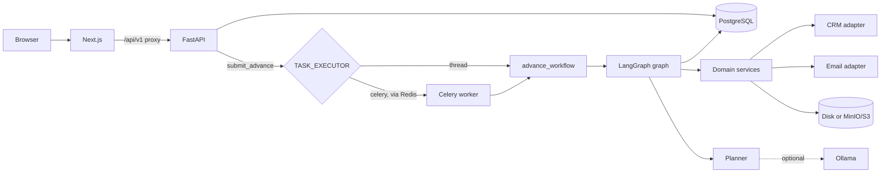
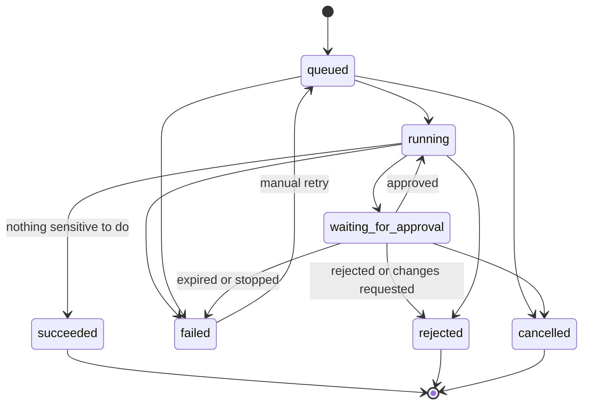

# Architecture overview

A modular monolith. One backend codebase runs as the API, and in Docker mode also as a Celery worker and scheduler. `IMPLEMENTATION.md` holds the target design; this page describes what is built.

## Layers

| Layer | Package | Rule |
|---|---|---|
| Routes | `app/api/v1` | Thin. Validate, check permission, call a service. |
| Auth | `app/auth` | `require(Permission)` produces an `Actor` carrying the organization. The role is reloaded for each request. |
| Services | `app/services` | All business rules, all deterministic. |
| Agents | `app/agents` | Graph, nodes, planner, prompts. Nodes call services and hold no business rules. |
| Adapters | `app/integrations` | The only code that knows about a provider. |
| Workers | `app/workers` | `submit_advance` is the single entry point, whichever executor is configured. |

## A workflow's life

`app/services/workflows/state_machine.py` holds the authoritative transitions; this diagram is a summary.

Graph nodes run in this order, skipping any the plan does not need: `plan`, `resolve_customer`, `create_invoice`, `generate_report`, `draft_email`, `request_approval`, `await_approval`, then `execute_actions` and `complete`, or `stop_after_decision`. `execute_actions` returns to `request_approval` if its approval no longer applies.

`advance_workflow` in `app/agents/runner.py` is the only thing that moves a workflow. It takes a PostgreSQL advisory lock per workflow, reads the latest checkpoint and continues from there. That makes it safe to call twice, and safe after a crash. A maintenance job expires overdue approvals, restarts stuck runs and dispatches the outbox: a thread in local mode, Celery beat in Docker mode.

## The approval boundary

1. `build_snapshot` builds the action list only from trusted records: the CRM recipient, the calculated total, and artifact checksums.
2. `payload_hash` is SHA-256 over the canonical JSON. The approval stores both the snapshot and the hash.
3. `decide` rechecks tenant, permission, expiry and whether a rebuilt snapshot still hashes the same. If it does not, the approval expires and a new one is issued.
4. `verify_for_execution` runs again at execution time. An approver who has been demoted or deactivated stops the run, and so does a stored payload that was altered.
5. If the action changed after approval, or the approval window has passed, the approval expires, nothing runs, and the graph goes back to `request_approval` for a new one.
6. `execute_approved` works through the stored payload only. The planner is never called again.

## Side-effect safety

`run_operation` in `app/services/reliability/operations.py` wraps every provider call:

- A stable operation key per workflow, action and payload hash, unique in PostgreSQL. A key that already succeeded returns the stored result without calling the provider.
- Temporary errors retry with bounded backoff and jitter, honouring `Retry-After`. Validation and authorization errors are tried once.
- An unknown outcome calls `reconcile` (asking the provider) before any repeat. That state survives a provider disconnect, so a later retry still reconciles first.
- When attempts run out, the operation becomes `manual_review_required` and the workflow fails visibly.

## Tenant isolation

Every business table has `organization_id`, and every query filters on it. A resource in another organization returns 404, so its existence is not revealed. The audit table rejects `UPDATE` and `DELETE` through a database trigger.

## Untrusted input

Requests, CRM notes, uploads and model output are treated as data. Customer emails use fixed templates, so neither AI text nor CRM notes reach a customer. The model's plan cannot name a recipient (the schema forbids extra fields), and its numbers and customer name must literally appear in the request.

## Observability

- JSON logs through structlog, with correlation IDs and redaction of tokens and secrets.
- The correlation ID is carried on the workflow row into background work and audit rows.
- `/metrics` on the API, and on port 9101 of the worker when `WORKER_METRICS_PORT` is set. The worker uses a single process with a thread pool so one registry holds everything.
- OpenTelemetry spans for HTTP, graph nodes and runs, exported when `OTEL_EXPORTER_OTLP_ENDPOINT` is set. Compose does not include a collector.

## Decisions

- [0001: Run locally without Docker](../decisions/0001-local-run-without-docker.md)
- [0002: Rules planner by default](../decisions/0002-rules-planner-by-default.md)
